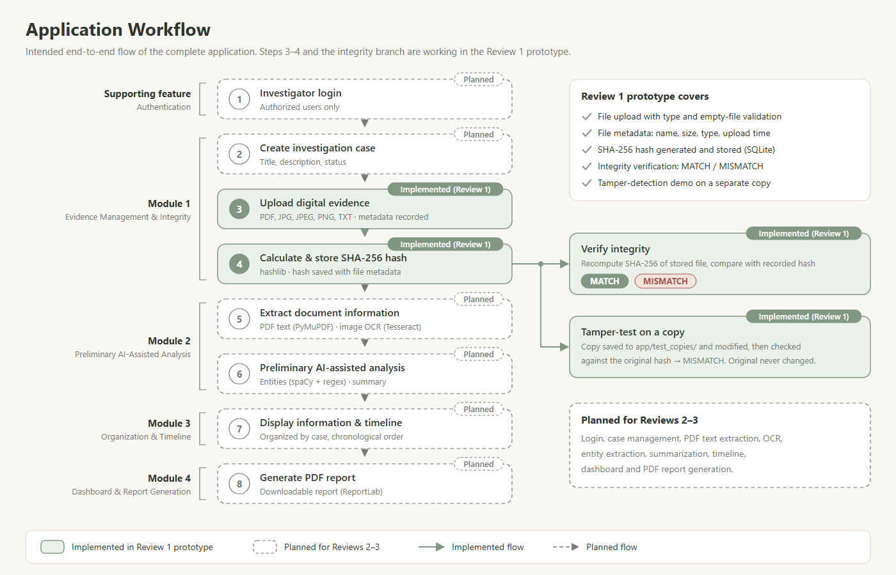

# Application Workflow



*Source: [diagrams/application-workflow.svg](diagrams/application-workflow.svg)*

## Intended workflow of the complete application

| Step | Activity | Module | Review 1 status |
|---|---|---|---|
| 1 | Investigator logs in (or switches demo identity) | Authentication | **Implemented** |
| 2 | Investigator creates / manages investigation cases | Module 1 | **Implemented** |
| 3 | Investigator uploads digital evidence (PDF, JPG, JPEG, PNG, TXT) linked to a case | Module 1 | **Implemented** |
| 4 | System calculates the SHA-256 hash and records immutable metadata | Module 1 | **Implemented** |
| ↳ | Live integrity verification: recalculate hash and show MATCH / MISMATCH | Module 1 | **Implemented** |
| ↳ | Controlled tamper-detection demonstration on an isolated copy | Module 1 (demo) | **Implemented** |
| ↳ | Chain-of-custody forensic audit logging of all operations | Module 1 | **Implemented** |
| 5 | Preliminary document content & image preview | Module 2 Foundation | **Implemented** |
| 6 | System performs preliminary AI-assisted analysis (entities, summary) | Module 2 | Planned (Review 2) |
| 7 | Chronological evidence timeline display | Module 3 | Planned (Review 2/3) |
| 8 | Downloadable structured PDF investigation report | Module 4 | Planned (Review 3) |

## Step details

1. **Login.** Only authorised users can access cases. Passwords are stored as
   salted hashes.
2. **Create case.** Title, description and status. The case is linked to the
   creating user.
3. **Upload evidence.** The file is validated (type, size, non-empty, content
   signature), saved under a server-generated name and its metadata recorded.
4. **Hash.** SHA-256 is calculated from the saved file and stored. It is never
   modified afterwards.
5. **Extract.** PyMuPDF reads text from PDFs. Tesseract OCR reads text from images.
6. **Analyse.** Regular expressions find phone numbers, e-mail addresses and
   dates; spaCy finds names and places. An optional summary may be generated.
   All output is labelled as preliminary.
7. **Display and timeline.** Evidence and extracted details are shown per case.
   Dates are placed on a timeline.
8. **Report.** ReportLab produces a PDF listing the case details, evidence files,
   hashes, verification status and preliminary findings.

## Review 1 prototype workflow

```
Choose file ──► Validate ──► Save original (app/uploads/) ──► SHA-256 ──► Store metadata + hash
                   │                                                         │
                   └─ error message (invalid / empty / too large)            ▼
                                                                   File information page
                                                                     │                 │
                                                       Verify integrity        Tamper test on a copy
                                                       (MATCH / MISMATCH)      (copy: MISMATCH,
                                                                                original: MATCH)
```
