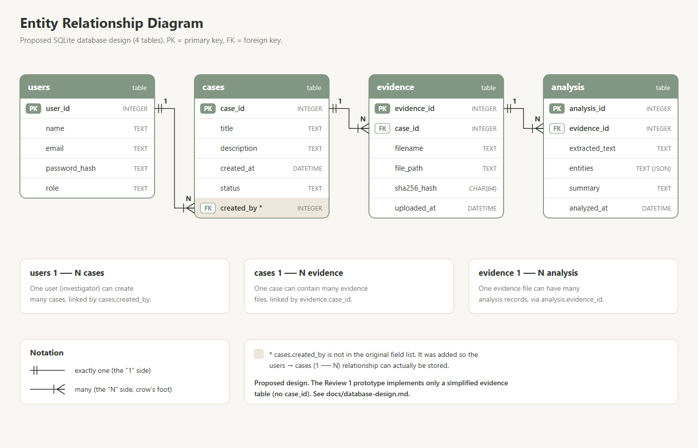

# Database Design

*Source: [diagrams/er-diagram.svg](diagrams/er-diagram.svg)*

This is the **proposed** database design for the complete application (SQLite).
The Review 1 prototype implements only a simplified evidence table. See the
last section.

## Tables

### users
| Column | Type | Notes |
|---|---|---|
| user_id | INTEGER | Primary key |
| name | TEXT | Investigator's name |
| email | TEXT | Unique login identifier |
| password_hash | TEXT | Salted password hash (never the plain password) |
| role | TEXT | e.g. `investigator`, `admin` |

### cases
| Column | Type | Notes |
|---|---|---|
| case_id | INTEGER | Primary key |
| title | TEXT | Short case title |
| description | TEXT | Case description |
| created_at | DATETIME | When the case was created |
| status | TEXT | e.g. `open`, `under review`, `closed` |
| created_by | INTEGER | **Foreign key → users.user_id** *(added, see note)* |

### evidence
| Column | Type | Notes |
|---|---|---|
| evidence_id | INTEGER | Primary key |
| case_id | INTEGER | Foreign key → cases.case_id |
| filename | TEXT | Original file name (display only) |
| file_path | TEXT | Server-side storage path |
| sha256_hash | CHAR(64) | SHA-256 recorded at upload |
| uploaded_at | DATETIME | Upload time |

### analysis
| Column | Type | Notes |
|---|---|---|
| analysis_id | INTEGER | Primary key |
| evidence_id | INTEGER | Foreign key → evidence.evidence_id |
| extracted_text | TEXT | Text from PDF extraction or OCR |
| entities | TEXT (JSON) | e.g. `{"phones": [...], "emails": [...], "dates": [...]}` |
| summary | TEXT | Preliminary summary (requires investigator review) |
| analyzed_at | DATETIME | When the analysis ran |

## Relationships

| Relationship | Cardinality | Implemented by | Meaning |
|---|---|---|---|
| users → cases | 1 : N | `cases.created_by` | One user (investigator) can create many cases; each case is created by one user. |
| cases → evidence | 1 : N | `evidence.case_id` | One case can contain many evidence files; each evidence file belongs to one case. |
| evidence → analysis | 1 : N | `analysis.evidence_id` | One evidence file can have several analysis records (for example, re-running OCR, or separate text and summary runs); each analysis record refers to one file. |

**Note on `cases.created_by`:** the initial field list for `cases` did not
include a link to `users`. A foreign key is required to store the
"one user creates many cases" relationship, so `created_by` has been added.
This is the only addition to the agreed field lists.

**Integrity rule:** `evidence.sha256_hash` is written once, at upload, and is
never updated. Verification always compares a freshly calculated hash against
this stored value.

## What the Review 1 prototype implements

The prototype implements the core relational architecture (see `app/db.py`):

1. **`users` Table:** Stores officer identities, roles, badges, and salted password hashes (`werkzeug.security`).
2. **`cases` Table:** Stores official investigation cases with case number, title, description, priority, status, and creator foreign key.
3. **`evidence` Table:** Stores digital evidence records with cryptographic SHA-256 hash, file metadata, safe UUID storage path, and foreign key linkage to `cases.case_id`.
4. **`activity_logs` Table:** Complete immutable chain-of-custody audit trail recording all officer logins, case creations, evidence uploads, integrity verifications, and tamper demonstrations.

The `analysis` table (Module 2: NLP entity extraction, OCR, and AI summarization) is planned for the subsequent review milestone.
