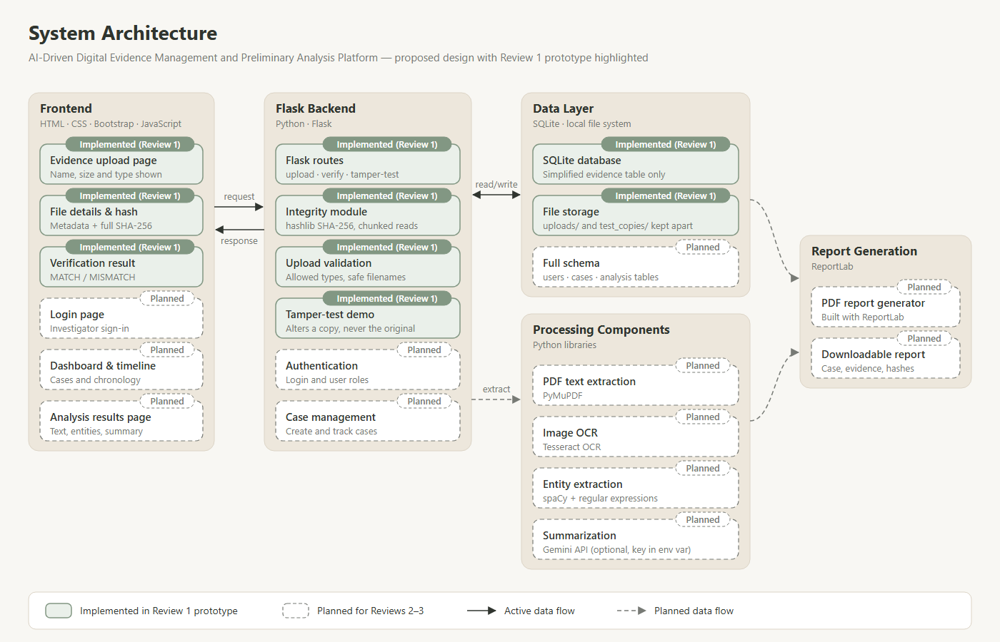

# System Architecture



*Source: [diagrams/system-architecture.svg](diagrams/system-architecture.svg).
Solid sage boxes are implemented in the Review 1 prototype; dashed boxes are planned.*

## Overview

The application follows a simple three-layer web architecture with no
microservices or container infrastructure:

```
Browser (HTML/CSS/Bootstrap/JS)
        │  HTTP requests / responses
        ▼
Flask backend (Python): routes, validation, integrity module
        │
        ├──► SQLite database (metadata, hashes; later users, cases, analysis)
        ├──► File storage (uploads/ for originals, test_copies/ for demo copies)
        ├──► Processing components (planned): PyMuPDF, Tesseract, spaCy + regex, Gemini (optional)
        └──► Report generation (planned): ReportLab → downloadable PDF
```

## Components

| Layer | Component | Technology | Status |
|---|---|---|---|
| Frontend | Executive dashboard, evidence upload, file inspection, verification result, cases explorer, login, audit trail | HTML, CSS, Bootstrap 5 (served locally), basic JavaScript | **Implemented** |
| Frontend | Timeline view, AI analysis results display | Same | Planned (Module 3/4) |
| Backend | Flask routes: auth, dashboard, cases, upload, view, verify, tamper test, audit trail | Python, Flask | **Implemented** |
| Backend | Integrity module: SHA-256 hashing, verification, tamper-test copy | Python `hashlib`, `shutil` | **Implemented** |
| Backend | Upload validation: allowed types, empty file, size limit, content signature, server-generated UUID names | Flask / Werkzeug | **Implemented** |
| Backend | Authentication & Session Management (salted password hashing) | Werkzeug Security, Flask Session | **Implemented** |
| Backend | Case Management & Audit Logging | Flask, SQLite | **Implemented** |
| Data | Relational schema: `users`, `cases`, `evidence`, `activity_logs` | SQLite via Python `sqlite3` | **Implemented** |
| Data | Analysis schema: `analysis` (OCR & NLP results) | SQLite | Planned (Module 2) |
| Data | File storage: `app/uploads/` (originals) and `app/test_copies/` (demo copies), kept separate | Local file system | **Implemented** |
| Processing | Text & Image Preview (Review 2 sneak-peek) | Native Python file handling | **Implemented** |
| Processing | PDF text extraction & OCR | PyMuPDF, Tesseract OCR | Planned (Module 2) |
| Processing | Entity extraction & Summarisation | spaCy, regular expressions, Gemini API (optional) | Planned (Module 2) |
| Reporting | PDF report generation | ReportLab | Planned (Module 4) |
| Tooling | Version control & Testing | Git, GitHub, pytest | In use |

## Implemented request flow (Review 1)

1. **Upload:** `POST /upload`. The browser sends the file. Flask checks the
   extension, rejects empty files and files over 16 MB, and checks that the
   content signature matches the extension. It then saves the file under a
   random server-generated name in `app/uploads/`, calculates its SHA-256 hash
   in 64 KB chunks, and inserts a metadata row into SQLite.
2. **View:** `GET /evidence/<id>`. Shows the metadata and the full recorded hash.
3. **Verify:** `POST /evidence/<id>/verify`. Recalculates the hash of the stored
   original and compares it with the recorded value (MATCH / MISMATCH / MISSING).
4. **Tamper test:** `POST /evidence/<id>/tamper-test`. Copies the original into
   `app/test_copies/`, appends one line to the **copy**, and verifies the copy
   (MISMATCH) and the original (MATCH) against the recorded hash.

## Design decisions

- **Server-generated file names** (`<uuid>.<ext>`). The user's file name is
  never used in a file path, which prevents path-traversal attacks and name
  collisions. The original name is stored only for display.
- **Separate folders** for original evidence and demonstration copies, so the
  two can never be confused.
- **Chunked hashing**, so large files do not need to be loaded into memory.
- **Bootstrap served locally**, so the demo works without an internet connection.
- **Secrets from environment variables** (`SECRET_KEY`, and later `GEMINI_API_KEY`).
  Nothing secret is committed. See `.env.example`.
- **No unnecessary infrastructure.** A single Flask app with SQLite is
  sufficient for the project's scale.
