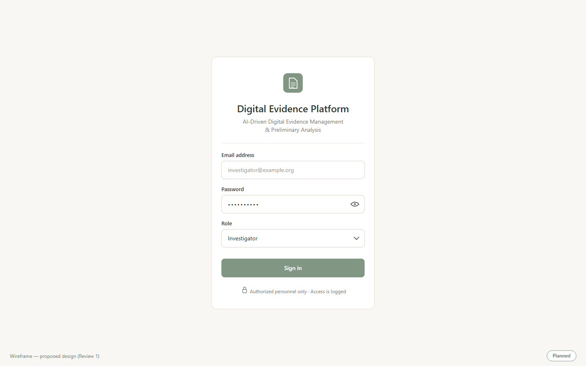
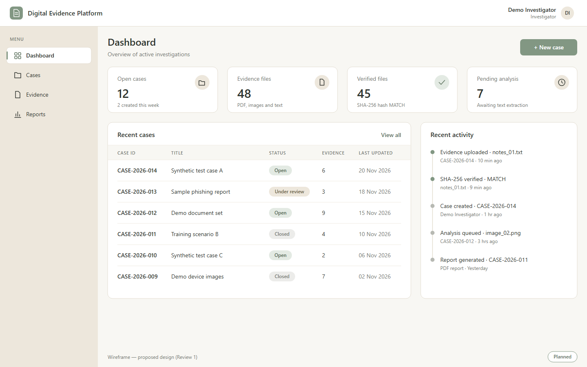
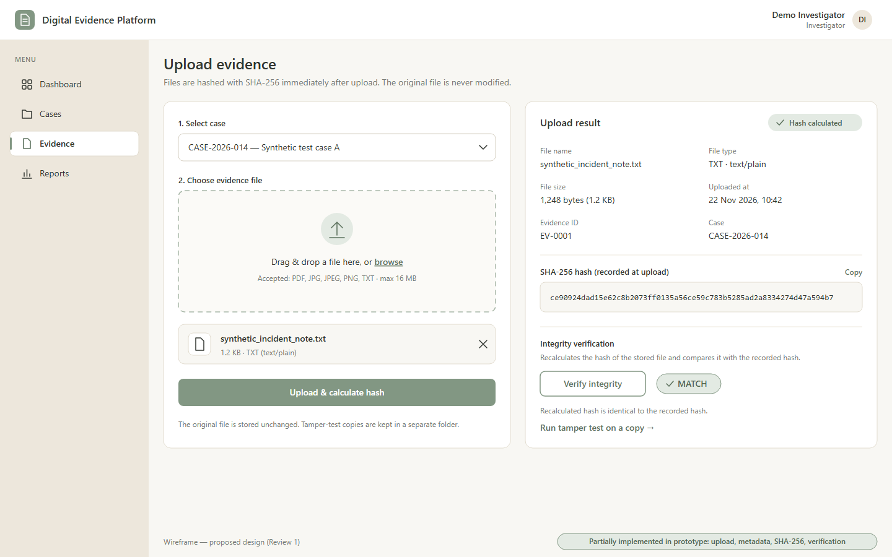
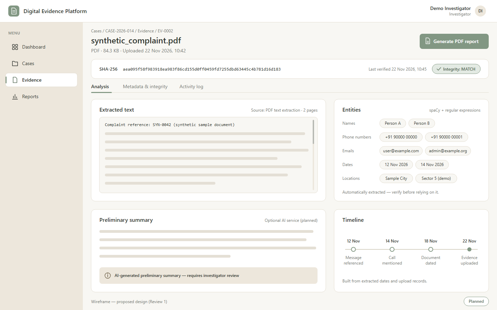

# UI Wireframes

These are **design wireframes for the proposed application**. They are not
screenshots of implemented screens. Only the upload, metadata, SHA-256 and
verification parts of wireframe 03 exist in the Review 1 prototype.
All data shown is synthetic.

Each wireframe is an SVG (editable source) with a PNG export for slides.

| # | Screen | File | Status |
|---|---|---|---|
| 1 | Login page | [01-login.png](01-login.png) | Planned |
| 2 | Main dashboard | [02-dashboard.png](02-dashboard.png) | Planned |
| 3 | Evidence upload | [03-evidence-upload.png](03-evidence-upload.png) | Partially implemented in prototype |
| 4 | Evidence analysis results | [04-analysis-results.png](04-analysis-results.png) | Planned |

## Visual theme

| Token | Colour | Use |
|---|---|---|
| Warm off-white | `#F8F7F3` | Page background |
| Soft beige | `#EDE7DC` | Sidebar, secondary surfaces, neutral pills |
| White | `#FFFFFF` | Cards |
| Muted sage green | `#829783` | Primary buttons, accents, MATCH status |
| Dark charcoal | `#30352F` | Main text |
| Secondary grey | `#777A75` | Secondary text, labels |

A muted terracotta (`#A4553F`) is used sparingly for errors and the MISMATCH
status, so that a failure is visible at a glance.

Characteristics: spacious layouts, rounded cards (10–12 px radius), 1 px
subtle borders, minimal shadows, simple line icons and a clear typographic
hierarchy. Light theme by default; no gradients or decorative animation.

## Screens

### 1. Login page

A centred card with the platform name, e-mail and password fields, a role
indicator, a primary "Sign in" button and an "Authorised personnel only" note.

### 2. Main dashboard

A header with the user menu and a sidebar (Dashboard, Cases, Evidence, Reports).
Four summary cards (open cases, evidence files, verified files, pending
analysis), a recent cases table with status pills, and a recent activity list
(basic activity log).

### 3. Evidence upload

A case selector, a drag-and-drop zone listing the allowed types and size limit,
a selected-file row (name, size, type), and an "Upload & calculate hash" button.
The result card shows the metadata, the full SHA-256 hash, a "Verify integrity"
action with a MATCH badge, and a link to the tamper test.

### 4. Evidence analysis results

A file header with the hash and integrity status, and a "Generate PDF report"
action. Below it are extracted text, entity chips (names, phone numbers,
e-mails, dates, locations), a preliminary summary clearly labelled as requiring
investigator review, and a small timeline.
